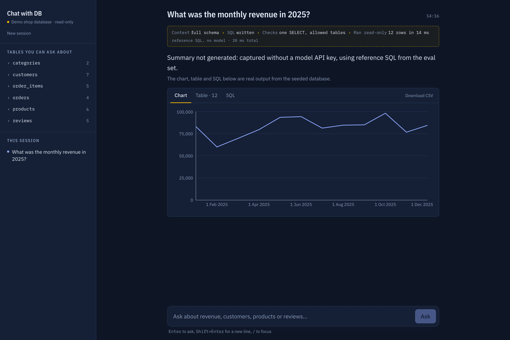
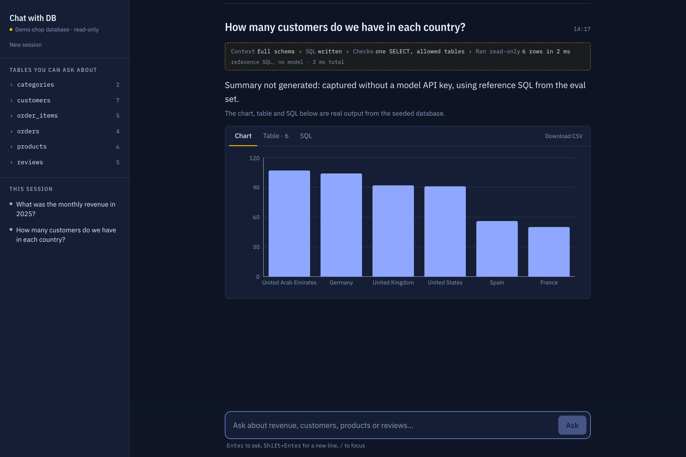
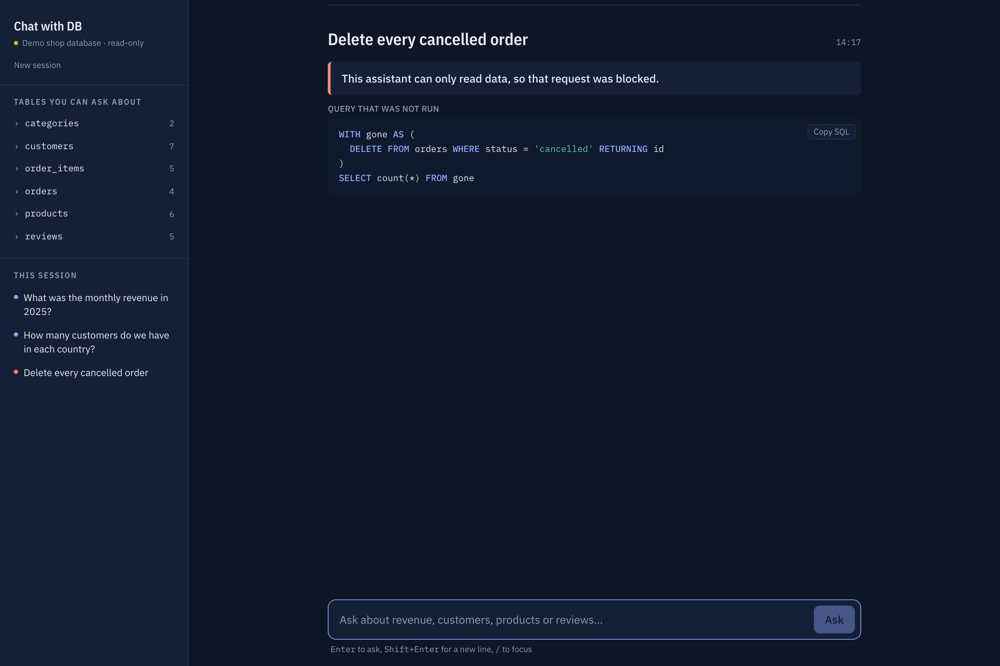
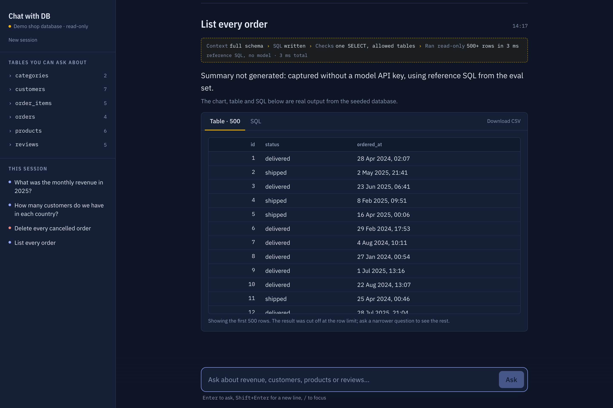
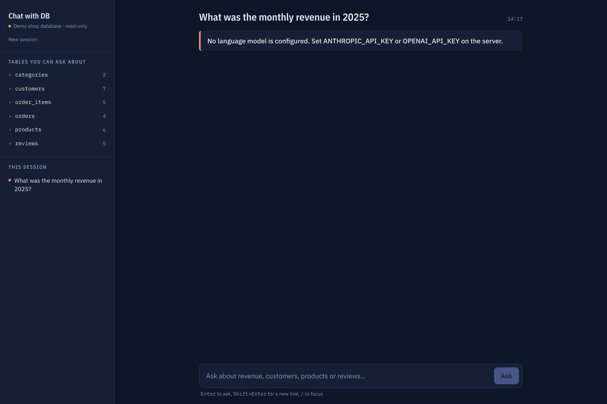
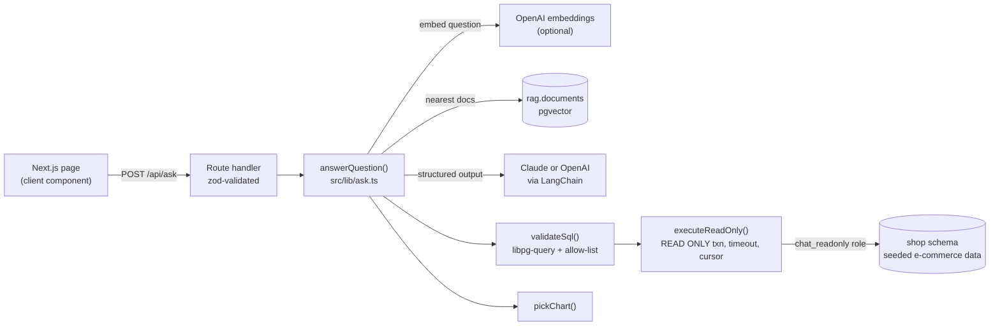

# Chat with DB

**Ask a Postgres database a question in plain English. Get an answer, the SQL behind it, the rows and a chart, with the query locked down so it can only read.**

   



Text-to-SQL demos are easy to build and hard to trust. The model can write a query that deletes data, reads tables it should not, runs for minutes or returns a million rows. This project is a text-to-SQL app built around that problem. Every generated query is parsed, checked against an allow-list, run in a read-only transaction with a timeout and a row cap, and executed by a database role that cannot write even if every other check failed. The quality of the SQL itself is measured with an eval suite rather than assumed.

It runs locally against a seeded e-commerce database. It is not deployed anywhere public.

**Demo video:** [docs/demo/demo.webm](docs/demo/demo.webm) (35 s). The screenshots and video were recorded without a model API key, using reference SQL in place of the model, so the summary line is a placeholder; see [docs/demo](docs/demo/README.md) for exactly what was and was not real.

## What it does

A user types a question such as "What was the monthly revenue in 2025?". The app:

1. finds the parts of the schema and the example queries most relevant to the question (pgvector)
2. asks Claude or OpenAI for a single SQL query, using structured output
3. validates the query with Postgres's own parser and an allow-list
4. runs it as a read-only role, with a time limit and a row limit
5. asks the model for a one to three sentence answer based on the returned rows
6. picks a chart from the shape of the result (dates give a line, categories give bars)

The SQL is always shown, so the answer can be checked rather than taken on faith. If the model writes a query that fails validation or errors in Postgres, it gets the reason and one chance to fix it.

It is aimed at people who know what they want to ask but not how to write the join, and at engineers who want a reference for doing text-to-SQL safely.

## Features

|                                           |                                                                                                                                                                                                                   |
| ----------------------------------------- | ----------------------------------------------------------------------------------------------------------------------------------------------------------------------------------------------------------------- |
| **Answer, SQL, table and chart together** | The summary is backed by the exact query and rows, in Chart, Table and SQL tabs, with CSV download. Results that hit the row limit say so.                                                                        |
| **A receipt for every answer**            | A strip above each answer shows what happened: whether retrieval matched tables or used the full schema, whether the SQL was rewritten, that the checks passed, and the row count and query time from the server. |
| **Read-only by construction**             | Three independent layers (below). A request like "Delete every cancelled order" is blocked and the rejected query is shown.                                                                                       |
| **Self-repair**                           | Unknown columns, syntax errors and disallowed functions are fed back to the model once. Safety rejections and timeouts are not retried.                                                                           |
| **Claude or OpenAI**                      | One `LanguageModel` interface over LangChain. The provider is chosen by env vars.                                                                                                                                 |
| **Schema-aware retrieval**                | Table descriptions and curated example queries are embedded in pgvector. With no embeddings key it falls back to the full schema.                                                                                 |
| **Execution-accuracy evals**              | 18 questions with reference SQL plus 3 that must be refused, scored by comparing result rows, not SQL text.                                                                                                       |
| **No raw errors in the browser**          | Every failure maps to a typed code and a fixed message. Database and provider errors stay in server logs.                                                                                                         |
| **Schema at hand**                        | The sidebar lists the tables and columns the read-only role can query (from `GET /api/schema`), plus this session's questions.                                                                                    |

<table>
  <tr>
    <td></td>
    <td></td>
  </tr>
  <tr>
    <td align="center">Category breakdown as bars, with the query receipt</td>
    <td align="center">A write request is blocked and the query is shown</td>
  </tr>
  <tr>
    <td></td>
    <td></td>
  </tr>
  <tr>
    <td align="center">Large results stop at the row limit and say so</td>
    <td align="center">Configuration problems get a plain message</td>
  </tr>
</table>

More: [empty state](docs/screenshots/01-home.png), [SQL tab](docs/screenshots/09-sql-tab.png), [light theme](docs/screenshots/08-light-theme.png), mobile [home](docs/screenshots/07-mobile-home.png) and [answer](docs/screenshots/07-mobile-answer.png).

## Architecture



The pipeline in `src/lib/ask.ts` does no I/O itself. The model, retrieval, validator and executor are passed in, which is what lets the unit tests drive it with a scripted fake model and lets the evals run it with the reference SQL. `src/lib/ask-service.ts` wires in the real database and model.

Two Postgres roles keep the halves apart: `chat_app` owns the `rag` schema used for retrieval, and `chat_readonly` runs generated SQL and can only read `shop`.

### Decisions worth calling out

- **Postgres's real parser, not a regex.** `libpg-query` is the Postgres parser compiled to WebAssembly, so the validator sees exactly what Postgres would. That catches data-modifying CTEs (`WITH x AS (DELETE ...) SELECT ...`), `SELECT INTO` and `FOR UPDATE`, which string checks miss.
- **Allow-list functions instead of deny-listing.** Postgres has hundreds of built-ins, and some (`pg_sleep`, `pg_read_file`, `dblink`, `set_config`, `lo_import`) are dangerous. Only common aggregate, window, date, text and math functions pass.
- **A cursor for the row limit.** Wrapping the query in `SELECT * FROM (...) LIMIT n` does not guarantee the inner `ORDER BY` survives. `DECLARE ... CURSOR` plus `FETCH n+1` keeps the query as written, stops Postgres early, tells the UI when the result was cut off, and only accepts `SELECT`/`VALUES`.
- **The allow-list comes from the database.** Allowed tables are read from `information_schema` as the read-only role, which only lists what that role can access, so the validator and the grants cannot drift apart.
- **Charts are chosen by rule, not by the model.** A deterministic picker is free, testable and cannot hallucinate a chart type. Numeric `id` columns are never plotted.
- **Native structured output.** LangChain's `jsonSchema` method maps to each provider's structured-output API. Current Claude models reject forced tool calls, so the tool-calling route was not an option. Output is validated again with zod.

## SQL safety layers

| Layer         | What it enforces                                                                                                                                                                                        | Code                      |
| ------------- | ------------------------------------------------------------------------------------------------------------------------------------------------------------------------------------------------------- | ------------------------- |
| Validator     | One statement, `SELECT` only (CTEs allowed). No data-modifying CTEs, `SELECT INTO` or row locks. Tables only from `shop`, and only those the read-only role can see. Functions only from an allow-list. | `src/lib/sql/validate.ts` |
| Executor      | `BEGIN READ ONLY`, `SET LOCAL statement_timeout`, a cursor fetching `limit + 1` rows, rollback in `finally`, and a broken connection is destroyed rather than returned to the pool.                     | `src/lib/sql/execute.ts`  |
| Database role | `chat_readonly` has `SELECT` on `shop` only, no access to `rag`, no `CREATE`, `default_transaction_read_only = on` and a 5 s `statement_timeout`.                                                       | `db/roles.sql`            |

The integration tests check the role on its own with the validator bypassed: an `INSERT` fails in a default transaction (read-only) and again inside `BEGIN READ WRITE` (no privilege).

## Tech stack

| Area                | Used                                                                                                     |
| ------------------- | -------------------------------------------------------------------------------------------------------- |
| Frontend            | Next.js 16 App Router, React 19, Tailwind CSS 4, Recharts                                                |
| Backend             | Next.js route handler, zod                                                                               |
| AI                  | LangChain (`@langchain/anthropic`, `@langchain/openai`), Claude or OpenAI chat models, OpenAI embeddings |
| Database            | Postgres 18 with pgvector 0.8 (Docker image `pgvector/pgvector:0.8.7-pg18`), `pg`, `libpg-query`         |
| Testing and tooling | Vitest, ESLint, Prettier, TypeScript strict, tsx, GitHub Actions                                         |

## Getting started

Requirements: Node 22.12 or newer (`.nvmrc`), Docker, and an Anthropic or OpenAI API key.

```bash
npm install
cp .env.example .env.local
```

Add `ANTHROPIC_API_KEY` or `OPENAI_API_KEY` to `.env.local`, then:

```bash
npm run db:up
```

```bash
npm run dev
```

`npm run db:up` starts Postgres with pgvector on `localhost:5443` and seeds it on first start. The app runs on `http://localhost:6601`. Optionally run `npm run index` (needs `OPENAI_API_KEY`) to build the retrieval index.

The seed uses a fixed random seed and fixed 2024 to 2025 dates, so every fresh database has identical rows: 500 customers, 80 products in 8 categories, 3,000 orders, 7,500 order lines and 1,200 reviews. `npm run db:reset` drops the volume and reseeds.

### Configuration

| Variable                 | Required         | Default                     | Purpose                                   |
| ------------------------ | ---------------- | --------------------------- | ----------------------------------------- |
| `DATABASE_URL`           | yes              |                             | `chat_app` role, retrieval store          |
| `READONLY_DATABASE_URL`  | yes              |                             | `chat_readonly` role, runs generated SQL  |
| `ANTHROPIC_API_KEY`      | one key required |                             | Claude                                    |
| `OPENAI_API_KEY`         | one key required |                             | OpenAI chat, and embeddings for retrieval |
| `LLM_PROVIDER`           | no               | Anthropic if its key is set | `anthropic` or `openai`                   |
| `ANTHROPIC_MODEL`        | no               | `claude-sonnet-5-5`         |                                           |
| `OPENAI_MODEL`           | no               | `gpt-5-mini`                |                                           |
| `OPENAI_EMBEDDING_MODEL` | no               | `text-embedding-3-small`    | must produce 1536 dimensions              |
| `QUERY_ROW_LIMIT`        | no               | `500`                       | rows returned per question                |
| `QUERY_TIMEOUT_MS`       | no               | `5000`                      | statement timeout per question            |

The passwords in `docker-compose.yml` and `.env.example` are for the local container only.

## Scripts

| Script                                        |                                                |
| --------------------------------------------- | ---------------------------------------------- |
| `npm run dev` / `build` / `start`             | Next.js on port 6601                           |
| `npm run lint` / `typecheck` / `format:check` | ESLint, `tsc --noEmit`, Prettier               |
| `npm test`                                    | unit tests, no database needed                 |
| `npm run test:integration`                    | tests against the docker-compose database      |
| `npm run eval`                                | SQL-generation evals with the configured model |
| `npm run eval -- --reference`                 | eval harness self-test, no API key needed      |
| `npm run index`                               | build the pgvector retrieval index             |
| `npm run db:up` / `db:down` / `db:reset`      | local database                                 |

## API

`POST /api/ask` with `{ "question": "How many customers are in each country?" }` (3 to 500 characters).

The shape of a successful response (`200`), with rows shortened:

```json
{
  "ok": true,
  "answer": "One to three sentences written by the model.",
  "sql": "SELECT country, count(*) AS customers FROM customers GROUP BY country ORDER BY customers DESC",
  "explanation": "Counts customers per country.",
  "result": {
    "columns": [
      { "name": "country", "kind": "text" },
      { "name": "customers", "kind": "number" }
    ],
    "rows": [
      ["United Arab Emirates", 107],
      ["Germany", 104]
    ],
    "truncated": false
  },
  "chart": { "type": "bar", "x": 0, "y": [1] },
  "meta": {
    "model": "anthropic:claude-sonnet-5-5",
    "retrieval": "vector",
    "attempts": 1,
    "queryMs": 14,
    "totalMs": 2310
  }
}
```

`queryMs` is the time Postgres spent on the generated query; `totalMs` covers the whole pipeline, including model calls.

A failure has `ok: false`, a `code` and a fixed `message`, plus the generated `sql` when there was one. Status codes: `400` bad input, `422` blocked, unanswerable or invalid query, `503` model or database unavailable or not configured, `504` timeout, `500` anything else. There is no authentication.

`GET /api/schema` returns the tables and columns the read-only role can query (`{ schema, tables: [{ name, comment, columns: [{ name, type, references }] }] }`). The UI uses it for the sidebar; it reads from the same catalog as the validator's allow-list.

## Data model

All queryable tables live in the `shop` schema: `customers`, `orders` (status `pending`, `paid`, `shipped`, `delivered`, `cancelled` or `refunded`), `order_items` (quantity and the unit price actually paid), `products`, `categories` and `reviews` (1 to 5 stars). Revenue counts only paid, shipped and delivered orders; that rule lives in a table comment and in the prompt. The `rag.documents` table holds the embedded table descriptions and example questions.

## Testing and quality

| Suite                                              | What it covers                                                                                                                                                                                                                                                 | Last run                                                  |
| -------------------------------------------------- | -------------------------------------------------------------------------------------------------------------------------------------------------------------------------------------------------------------------------------------------------------------- | --------------------------------------------------------- |
| Unit (`npm test`, 92 tests)                        | Validator against valid and attack-style SQL, error mapping, env parsing, the pipeline with a scripted model (repair loop, no retry on writes or timeouts, no error details leaked, summary failure keeps the rows), chart choice, formatting, eval comparator | Passed locally                                            |
| Integration (`npm run test:integration`, 15 tests) | Typed results, row-limit truncation, timeouts, the read-only role with validation bypassed, schema introspection, pgvector retrieval with a deterministic embedder                                                                                             | Passed locally against Docker Postgres                    |
| Eval self-test (`npm run eval -- --reference`)     | Harness, comparator, and that every reference query passes the validator                                                                                                                                                                                       | 21/21 locally                                             |
| Model evals (`npm run eval`)                       | SQL generation accuracy with a real model                                                                                                                                                                                                                      | **Not run yet**: no API key was available                 |
| Browser                                            | Every screen above, mobile width, light and dark themes, error states                                                                                                                                                                                          | Checked by hand in a browser with stubbed model responses |

Lint, typecheck, format check and `next build` also pass locally. The CI workflow (`.github/workflows/ci.yml`) runs all of the above except model evals, which only run on `main` or a manual run when an `ANTHROPIC_API_KEY` secret is set. CI has not run yet because the repository has not been pushed.

### How evals are scored

Each question in `evals/cases.json` runs through the full pipeline and its rows are compared with the reference query's rows. Column names and order are ignored, extra columns are allowed (so `SELECT city, count(*)` matches a reference of `SELECT city`), row order only matters when the question asks for it, and numbers are compared at two decimals. The three refusal cases pass only if no rows come back. Few-shot examples are kept separate from eval questions so the score measures generation, not recall. `npm run eval` writes a JSON report to `evals/results/` and fails below 80% accuracy.

## Project structure

```
db/                    schema, deterministic seed, rag store, roles, init script
docs/                  screenshots and demo video
evals/                 eval cases, comparator, runner
scripts/               index-knowledge.ts
src/app/               page, POST /api/ask and GET /api/schema
src/components/        workspace shell, composer, answer entry, query receipt, result tabs
src/lib/ask.ts         the pipeline (dependencies passed in)
src/lib/ask-service.ts wires the pipeline to the real database and model
src/lib/sql/           validator, executor, error codes
src/lib/retrieval/     pgvector retrieval and few-shot examples
tests/                 unit and integration tests
```

## Deployment

There is no deployment yet. The app runs locally with Docker for Postgres. A Docker image with Kubernetes manifests for AWS is the next planned step.

## Status and limitations

Working locally end to end, with the model step verified only through tests and the reference model so far.

- No authentication or rate limiting, so anyone who can reach it can spend model credits. Do not expose it publicly as is.
- One question at a time; no follow-up questions that use earlier context.
- A question that needs a function outside the allow-list gets one repair attempt, then a "couldn't build a valid query" message.
- `bigint` and `numeric` values become JavaScript numbers, which loses precision above 2^53.
- Charts are line or bar only.
- The written summary sees at most 50 rows. The table and SQL are the source of truth.

## Roadmap (planned, not built)

- Run the model evals and publish accuracy per provider and model
- Docker image and Kubernetes manifests, deployed on AWS
- Rate limiting and an auth gate before any public deployment
- Follow-up questions with conversation context

## License

No license has been chosen yet, so all rights are reserved by default.

## Author

Usama Khaki. [github.com/UsamaKhaki](https://github.com/UsamaKhaki)
